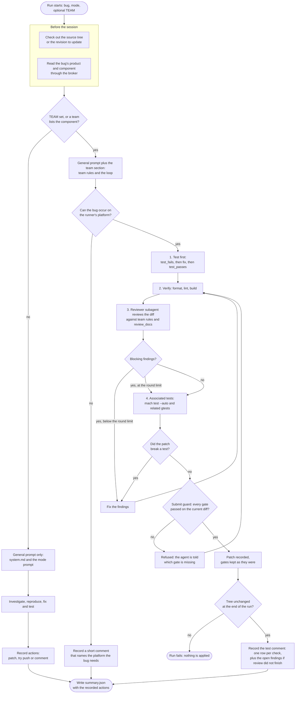

# bug-fix agent

The bug-fix agent investigates a Bugzilla bug, fixes it in the Firefox source tree, and
records the actions a person or hackbot-api then applies: a Phabricator patch, a try
push, a Bugzilla or Phabricator comment. It never posts anything itself.

A run starts from one of three modes: fix a bug, answer `@hackbot` comments on a
revision, or answer a Bugzilla needinfo. A run whose bug belongs to a team also follows
that team's rules and must pass a loop of checks before it may record a patch. See
[teams/README.md](hackbot_agents/bug_fix/teams/README.md) to add a team.

## Flow

A run that updates an existing revision skips step 1. Any change after step 2 repeats
steps 2 to 4. The round limit is 3 by default, and a team can change it with
`max_review_rounds`. At the limit the patch still needs its tests and checks to pass;
only the review may stay open, and the comment lists its findings for a person.
